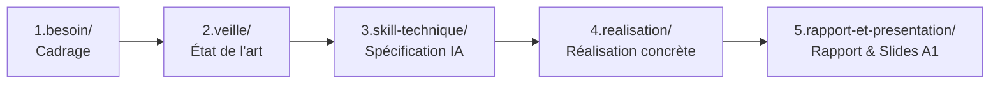

# 1. Mission
Ce méta-skill orchestre l'organisation et l'accompagnement méthodologique des **Labs techniques**. Il structure le projet de lab en **5 sous-dossiers clairs et concrets** pour permettre à l'apprenant de construire pas-à-pas la brique technique de son **Prototype de Projet Fil Rouge**.

**Principes Cardinaux du Skill :**
- **Organisation en 5 Sous-Dossiers Concrets :** Tout lab est organisé en sous-dossiers parlants pour l'apprenant : `1.besoin/`, `2.veille/`, `3.skill-technique/`, `4.realisation/`, et `5.rapport-et-presentation/`.
- **Colocalisation du Rapport et de la Présentation :** Dans `5.rapport-et-presentation/`, le rapport technique et les diapositives orales sont réunis pour supprimer tout risque d'oubli de la présentation.
- **Un Skill Technique Dédié pour chaque Lab :** Chaque sujet de Lab possède son propre skill technique spécialisé (ex: `lab-skill-engineering`, `lab-crud-laravel`) créé avec `plugin-dev`.
- **Non-Substitution :** Le méta-skill `lab-dev` ne doit jamais rédiger la solution technique ni la réalisation à la place de l'apprenant.
- **Accompagnement Oratoire A1 :** Il exige et valide une page de garde complète et exactement **3 phrases simples en français de niveau A1** dans les notes de l'orateur de chaque slide.

# 2. Déclenchement & Limites
- **Quand l'activer :**
  - Cadrage, démarrage ou structuration d'un nouveau Lab technique.
  - Création de l'arborescence des 5 sous-dossiers d'un lab.
  - Initialisation du fichier `README.md` et du fichier `Todo.md`.
  - Détermination du skill technique dédié nécessaire pour le lab.
  - Audit et validation avant la soutenance en sprint devant le formateur.
- **Quand NE PAS l'activer :**
  - Rédaction du contenu technique ou du code métier d'un lab ➔ Utiliser le **Skill Technique Dédié du Lab** (ex: `lab-skill-engineering`, `lab-crud-laravel`).
  - Conception formelle et normalisation d'un fichier `SKILL.md` ➔ Invoquer **`plugin-dev`**.

# 3. Entrées & Ressources à Charger
- **Priorité 1 :** `.agent/skills/lab-dev/resources/template-besoin.md` (Template guidé prêt à remplir pour `1.besoin/contexte-et-besoin.md`).
- **Priorité 2 :** `.agent/skills/lab-dev/resources/guide-organisation-dossiers.md` (Arborescence officielle en 5 sous-dossiers).
- **Priorité 3 :** `.agent/skills/lab-dev/resources/template-readme.md` (Modèle du README d'informations générales).
- **Priorité 4 :** `.agent/skills/lab-dev/resources/template-technical-lab-skill.md` (Modèle de skill technique de lab pour `plugin-dev`).
- **Priorité 5 :** `.agent/skills/lab-dev/resources/template-lab-structure.md` (Squelette normé de `Lab-[Sujet].md`).
- **Priorité 6 :** `.agent/skills/lab-dev/resources/template-presentation-slides.md` (Plan de présentation avec page de garde et notes A1).
- **Priorité 7 :** `.agent/skills/lab-dev/resources/template-todo.md` (Liste des tâches traversant les 5 sous-dossiers).
- **Priorité 8 :** `.agent/skills/lab-dev/resources/validation-checklist.md` (Critères d'audit et de validation avant le sprint).

# 4. Contraintes & Règles Inviolables
- **Respect de l'Arborescence des 5 Sous-Dossiers :**
  - `1.besoin/` : Problème métier/technique et rôle dans le prototype (`contexte-et-besoin.md`).
  - `2.veille/` : Veille technologique et benchmark (`veille-technologique.md`).
  - `3.skill-technique/` : Spécification du skill technique (`spec-skill.md`).
  - `4.realisation/` : Code source, maquettes, schémas ou configurations testées.
  - `5.rapport-et-presentation/` : `Lab-[Sujet].md` et `Presentation-[Sujet].md`.
- **Protection de `docs/` :** Le dossier `docs/` est réservé à la documentation de méthode de l'équipe. Aucun livrable de lab ne doit y être déposé.
- **Règle des Notes de Présentation (Niveau A1) :**
  - Chaque slide du plan de présentation comporte obligatoirement **exactement 3 phrases simples en français niveau A1**.
  - Vocabulaire professionnel et technique correct, sans phrases littéraires complexes ni infantilisation.
- **Obligation de la Page de Garde :** La présentation doit contenir le Titre, le Nom de l'apprenant, le Projet Fil Rouge, le Prototype, la Stack et la Date du sprint.

# 5. Procédure Pas-à-Pas (Workflow en 5 Sous-Dossiers)

### Étape 1 : Initialisation & Dossier `1.besoin/`
1. L'agent génère `README.md` (informations générales) et `Todo.md` (suivi des tâches).
2. L'agent crée le dossier `1.besoin/` avec le fichier `contexte-et-besoin.md` issu de `template-besoin.md`.
3. L'apprenant remplit ce template en 5 rubriques simples (projet fil rouge, prototype, besoin, position stack, critères).

### Étape 2 : Veille dans `2.veille/`
1. L'agent crée le dossier `2.veille/` avec `veille-technologique.md`.
2. L'apprenant recense les outils communautaires et compare les solutions existantes.

### Étape 3 : Spécification dans `3.skill-technique/`
1. L'agent crée le dossier `3.skill-technique/` avec `spec-skill.md`.
2. L'agent oriente vers **`plugin-dev`** pour concevoir le skill technique dédié sous `.agent/skills/lab-[nom]/` selon les 10 rubriques normées.

### Étape 4 : Réalisation concrète dans `4.realisation/`
1. L'agent crée le dossier `4.realisation/`.
2. L'apprenant développe et teste sa réalisation technique (code, maquette, configuration) en se faisant assister par le skill technique dédié.

### Étape 5 : Rapport et Présentation dans `5.rapport-et-presentation/`
1. L'agent génère dans `5.rapport-et-presentation/` les deux livrables :
   - `Lab-[Sujet].md` (rapport officiel du lab).
   - `Presentation-[Sujet].md` (slides avec page de garde et emplacements des 3 phrases de notes A1).
2. L'apprenant complète les deux fichiers en parallèle.
3. L'agent effectue l'audit de validation avec `validation-checklist.md` pour autoriser le sprint devant le formateur.

# 6. Gestion des Ambiguïtés & Décisions
- **Si l'apprenant ne sait pas quoi mettre dans 4.realisation :**
  L'agent explique : *« Mettez ici votre travail technique concret : vos fichiers de code si c'est un lab de dev, vos maquettes si c'est de l'UI, ou vos fichiers de configuration si c'est de l'architecture. »*
- **Si les notes orales de la présentation sont trop complexes :**
  L'agent reformule les notes pour obtenir **exactement 3 phrases simples et directes en français A1** faciles à prononcer.

# 7. Format de Sortie & Livrables
- À la racine : `README.md` et `Todo.md`.
- `1.besoin/contexte-et-besoin.md` complété.
- `2.veille/veille-technologique.md` documenté.
- `3.skill-technique/spec-skill.md` et `.agent/skills/lab-[nom]/SKILL.md`.
- `4.realisation/` contenant la production technique testée.
- `5.rapport-et-presentation/Lab-[Sujet].md` et `5.rapport-et-presentation/Presentation-[Sujet].md`.

# 8. Contrôle Qualité (Checklist Binaire)
- [ ] Les 5 sous-dossiers sont-ils présents et bien nommés ?
- [ ] Le template de besoin est-il complété par l'apprenant ?
- [ ] Le dossier `docs/` est-il exempt de tout livrable de lab ?
- [ ] Le skill technique dédié est-il créé sous `.agent/skills/` ?
- [ ] Le dossier `5.rapport-et-presentation/` réunit-il le rapport ET la présentation ?
- [ ] La présentation contient-elle une page de garde complète ?
- [ ] Chaque slide contient-elle exactement 3 phrases de notes orales en français A1 ?
- [ ] Le validateur `validate-skills.cjs` confirme-t-il 0 erreur sur tous les skills ?

# 9. Gestion des Erreurs Fréquentes
| Erreur Typique | Cause | Conduite Immédiate |
| :--- | :--- | :--- |
| Mettre des livrables de lab dans docs/ | Confusion des dossiers | Déplacer les livrables dans les sous-dossiers 1 à 5 |
| Séparer le rapport et la présentation | Risque d'oubli des slides | Regrouper les deux fichiers dans `5.rapport-et-presentation/` |
| Remplir la présentation à la dernière minute | Mauvaise gestion du temps | Initialiser les slides dès l'étape 1 et remplir au fur et à mesure |
| Notes orales de présentation trop littéraires | Niveau inadapté | Reformuler en 3 phrases directes de niveau A1 par slide |

# 10. Exemples Concrets (Few-Shot)

**Exemple d'Invocation :**
*Apprenant : « Je prépare mon lab sur Alpine.js pour mon projet CarRental. »*

**Comportement de l'agent `lab-dev` :**
1. L'agent initialise `README.md` et `Todo.md`.
2. Il crée `1.besoin/contexte-et-besoin.md` avec le template guidé.
3. Il crée `2.veille/veille-technologique.md`.
4. Il prépare `3.skill-technique/` et fait concevoir `lab-alpinejs` via `plugin-dev`.
5. Il initialise `4.realisation/` pour accueillir les composants interactifs.
6. Il génère `5.rapport-et-presentation/` avec le rapport et les slides A1, puis accompagne l'apprenant jusqu'au sprint formateur.
