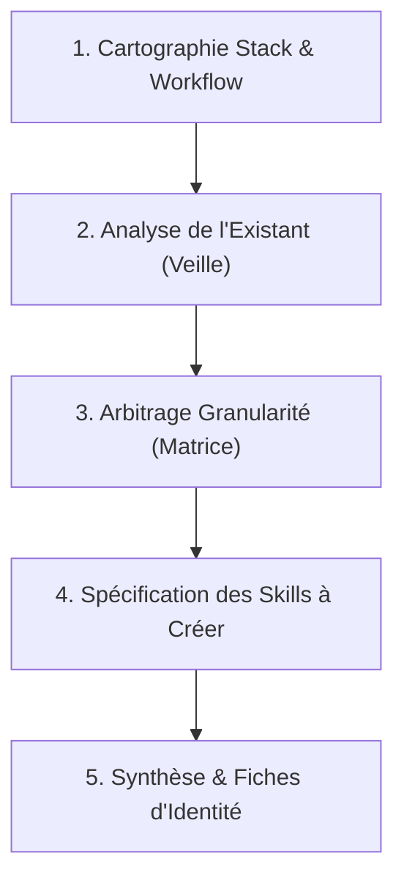

# 1. Mission
Ce skill est l'expert technique dédié au Lab actuel (**Lab Ingénierie des Skills**). Sa mission est d'analyser en profondeur notre **Stack Technique** (Laravel, Alpine.js, Preline UI, MySQL) et notre **Flux de Travail** (Analyse, Conception, Réalisation, Tests, Sprint), pour concevoir l'architecture globale des compétences IA et **déterminer la liste exacte des skills à créer ou à utiliser** pour réussir le prototype du projet fil rouge.

# 2. Déclenchement & Limites
- **Quand l'activer :**
  - Demande d'architecture des compétences IA ("Comment organiser nos skills pour le projet fil rouge ?", "Quels skills créer pour notre stack ?").
  - Réalisation technique du Lab sur les skills.
  - Découpage et arbitrage de la granularité des skills (par technologie, par phase ou par fonctionnalité).
  - Décision d'arbitrage (réutiliser un skill communautaire vs créer un skill propre).
- **Quand NE PAS l'activer :**
  - Cadrage méthodologique global d'un lab et suivi du sprint ➔ Utiliser `lab-dev`.
  - Échafaudage de fichiers `SKILL.md` et validation syntaxique ➔ Utiliser `plugin-dev`.
  - Écriture de code applicatif métier (PHP, JS, CSS) ➔ Utiliser les skills techniques dédiés (ex: `lab-crud-laravel`).

# 3. Entrées & Ressources à Charger
- **Priorité 1 :** `.agent/skills/lab-skill-engineering/resources/matrice-stack-workflow.md` (Référentiel Stack x Workflow x Skills).
- **Priorité 2 :** `.agent/skills/lab-skill-engineering/resources/criteres-granularite.md` (Règles de décision pour la granularité des skills).
- **Priorité 3 :** `docs/01-demarche-realisation-lab.md` (Démarche officielle en 6 étapes).

# 4. Contraintes & Règles Inviolables
- **Règle de Granularité Optimale :** Interdiction de concevoir des micro-skills de quelques lignes (crée de la dispersion et des conflits) ou des mega-prompts monolithiques (sature la fenêtre de contexte). Privilégier la granularité méso : **Un skill technique dédié par brique de Lab**.
- **Respect Strict DRY / SSOT :**
  - Les contraintes permanentes transversales doivent être placées dans `.agent/rules/`.
  - Les ressources spécialisées à un seul skill doivent être encapsulées dans `<skill>/resources/`.
- **Compatibilité Multi-Agents :** Toute architecture de skills proposée doit pouvoir être exploitée sur **Claude Code** (CLI/fichiers), **Google Antigravity** (IDE/règles) et **GitHub Copilot**.
- **Justification Systématique :** Chaque proposition de skill à créer doit être justifiée par un besoin technique concret du prototype fil rouge.

# 5. Procédure Pas-à-Pas (Ingénierie des Skills)

### Étape 1 : Cartographie de la Stack et du Workflow
1. Identifier les technologies mobilisées dans le prototype (ex: Laravel 11, Alpine.js, Tailwind, Preline UI).
2. Décomposer le flux de travail de l'apprenant (Analyse ➔ Modélisation ➔ Backend ➔ Frontend ➔ Tests ➔ Sprint).

### Étape 2 : Analyse de l'Existant (Veille Technologique)
1. Évaluer les compétences disponibles dans la communauté (Anthropic `claude-plugins-official`, `agentskills.io`).
2. Identifier les manques par rapport à nos spécificités de stack et nos conventions d'école.

### Étape 3 : Arbitrage de la Granularité
1. Appliquer les critères de `criteres-granularite.md`.
2. Valider le découpage : 
   - 2 Méta-Skills de gouvernance (`lab-dev` pour la méthodologie, `plugin-dev` pour les normes).
   - 1 Skill Technique Dédié pour chaque Lab technique (`lab-crud-laravel`, `lab-alpinejs`, `lab-preline-ui`).

### Étape 4 : Spécification des Skills à Créer
Pour chaque compétence retenue, définir :
- Son nom normé en kebab-case (`lab-[sujet]`).
- Sa mission principale en 2 phrases simples.
- Ses 3 à 5 règles techniques obligatoires.
- Ses ressources internes encapsulées.

### Étape 5 : Formalisation de la Décision d'Architecture (ADR)
Rédiger le compte-rendu d'arbitrage à intégrer dans le document du lab pour la soutenance devant le formateur.

# 6. Gestion des Ambiguïtés & Décisions
- **Si l'apprenant hésite entre un skill général et des skills spécialisés :**
  Rappeler la règle : un skill spécialisé par Lab garantit un contexte propre et une évaluation claire en sprint devant le formateur.
- **Si une technologie est mineure ou éphémère :**
  Ne pas créer de skill dédié : documenter la règle dans les ressources du skill parent ou dans une règle contextuelle.

# 7. Format de Sortie & Livrables
- **La Matrice des Skills IA :** Tableau complet des compétences recommandées pour le projet fil rouge.
- **La Fiche de Spécification de chaque Skill :** Définition prête pour être transmise à `plugin-dev`.
- **L'ADR (Architecture Decision Record) :** Justification claire du découpage choisi pour le prototype.

# 8. Contrôle Qualité (Checklist Binaire)
- [ ] La cartographie couvre-t-elle toute notre stack de développement ?
- [ ] La règle de granularité méso (un skill par sujet de lab) est-elle respectée ?
- [ ] Le principe DRY / SSOT est-il garanti (aucune duplication de règles) ?
- [ ] Les compétences proposées sont-elles compatibles Claude Code et Antigravity ?
- [ ] Le validateur `validate-skills.cjs` confirme-t-il la conformité du skill ?

# 9. Gestion des Erreurs Fréquentes
| Erreur d'Architecture | Conséquence | Correction Immédiate |
| :--- | :--- | :--- |
| Créer un skill pour 2 lignes de prompt | Dispersion inutile | Regrouper dans les ressources d'un skill parent |
| Mettre toutes les technologies dans un seul skill | Saturation du contexte de l'agent | Découper en skills techniques dédiés par sujet de Lab |
| Dupliquer les règles de style dans chaque skill | Dette de maintenance | Déplacer les règles transversales dans `.agent/rules/` |

# 10. Exemples Concrets (Few-Shot)

**Exemple d'Invocation :**
*Apprenant : « Voici notre stack : Laravel 11, Alpine.js et Preline UI. Quel découpage de skills devons-nous adopter pour notre prototype fil rouge ? »*

**Comportement de `lab-skill-engineering` :**
1. L'agent analyse les interactions entre les 3 briques.
2. Il applique la grille de granularité et recommande :
   - Méta-gouvernance : `lab-dev` (méthodologie) + `plugin-dev` (génération).
   - Lab 1 : `lab-crud-laravel` (Backend, validation, Eloquent).
   - Lab 2 : `lab-alpinejs` (Interactivité légère, état local).
   - Lab 3 : `lab-preline-ui` (Composants UI accessibles).
3. Il fournit la fiche de spécification prête à être créée avec `plugin-dev` pour chaque lab.

