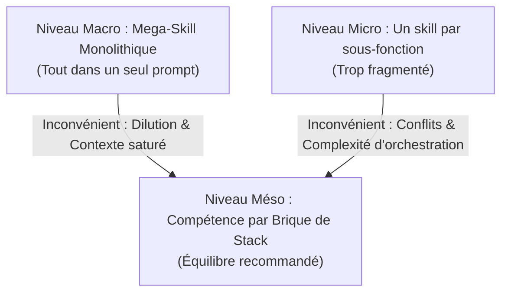

# Guide Technique : Critères de Granularité des Skills IA

Ce guide définit les règles d'ingénierie agentique pour décider de la taille et du périmètre de chaque compétence IA.

---

## 1. Les 3 Niveaux de Granularité

| Granularité | Description | Diagnostic | Recommandation |
| :--- | :--- | :--- | :--- |
| **Trop Macro (Monolithe)** | Un seul mega-skill qui tente de tout faire (Laravel + Alpine + Preline + Analyse). | L'IA oublie des règles au milieu du texte. Consommation excessive de tokens. | **À Éviter** |
| **Trop Micro (Dispersion)** | Un skill par petite tâche (ex: `skill-laravel-route`, `skill-laravel-migration`). | L'agent hésite entre 20 skills. Orchestration complexe et lente. | **À Éviter** |
| **Méso (Par Brique / Lab)** | **Un skill technique dédié par sujet de Lab** (`lab-crud-laravel`, `lab-alpinejs`). | Contexte ciblé, règles claires, apprentissage progressif. | **RECOMMANDÉ** |

---

## 2. Grille de Décision pour Créer un Nouveau Skill

Créer un nouveau skill technique si et seulement si :
1. **Périmètre clair :** La technologie possède ses propres règles d'ingénierie (ex: syntaxe Blade vs JavaScript Alpine).
2. **Réutilisabilité :** La brique sera utilisée plusieurs fois dans le prototype du projet fil rouge.
3. **Autonomie :** L'apprenant doit pouvoir tester et valider cette brique indépendamment en sprint devant le formateur.
4. **Volume de règles :** Il y a au moins 3 à 5 règles techniques spécifiques à respecter pour éviter les erreurs.

