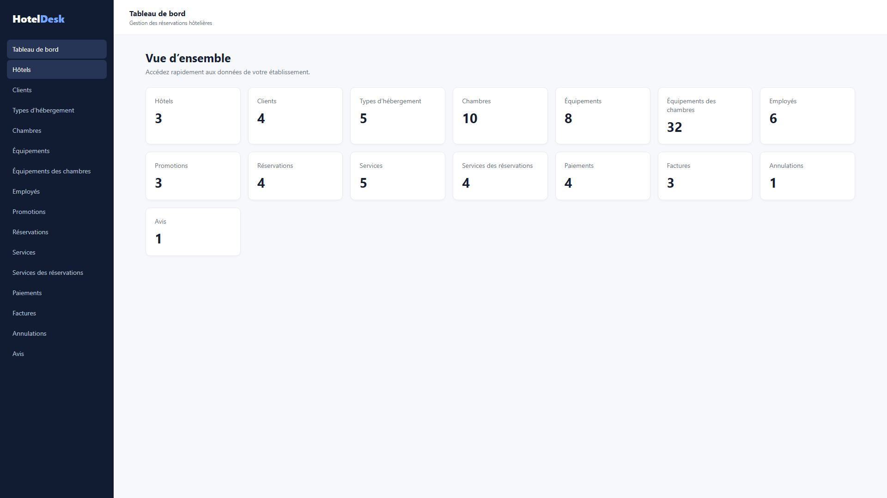

# Slide 1 — Sujet du Projet

Mon projet est une **plateforme de gestion des restaurants** où les gérants peuvent gérer les menus, les réservations et les commandes. C'est *personnel* — pas ~~juste une copie~~ des solutions existantes.

- Gestion des menus et plats
- Système de réservations en ligne
- Prise de commande digitale



> "La gestion de restaurant devrait être simple et digitale."

---

# Slide 2 — Objectif du Projet

L'objectif est de simplifier la gestion quotidienne des restaurants, tout en apprenant Markdown avec cette présentation. Voir le [Guide Markdown](https://www.markdownguide.org/).

1. Développer le module de gestion des menus
2. Créer le système de réservations
3. Implémenter la prise de commande

- [x] Module de gestion des catégories
- [x] API REST des plats
- [ ] Interface de réservation
- [ ] Écran cuisine

| Fonctionnalité | Technologies |
|:---|:---|
| Backend | Laravel + MySQL |
| Frontend | Alpine.js + Tailwind |

Configuration Laravel : `composer.json`

```json
{
  "require": {
    "laravel/framework": "^10.0",
    "laravel/sanctum": "^3.0"
  }
}
```
