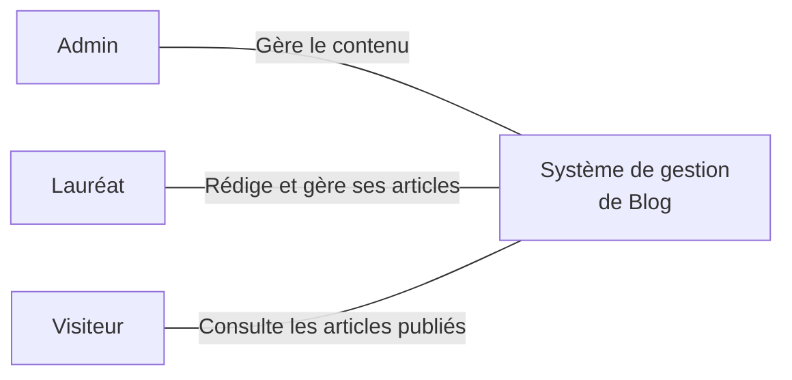

 

# Product Backlog

## Préparer le blog des lauréats

**Présenté par** : Mesbahi Mohammed Yassir
**Encadré par** : ES-Sarraj Fouad

---

## Plan de la présentation

- Introduction
- Problématique
- Solution
- Définition
- Acteurs
- Livrables

---

## Introduction

Avant le développement du blog, il faut comprendre ses utilisateurs et organiser leurs besoins.

Le lab Product Backlog permet de préparer le projet avant le développement.

---

## Problématique

La méthodologie Scrum nécessite l'existence d'un Product Backlog avant le démarrage du premier Sprint. Cependant, au début du projet, nous ne disposons pas encore d'une vision suffisamment claire des besoins réels des utilisateurs, de leurs problèmes et des fonctionnalités nécessaires.

---

## Définition

Le Product Backlog est une liste ordonnée des besoins et fonctionnalités à réaliser pour un produit.

Il est construit à partir des besoins validés des utilisateurs et priorisé avant le Sprint Planning.

---

## Solution

- Identifier les acteurs et leurs interactions
- Comprendre besoins, attentes et difficultés via Design Thinking
- Transformer les besoins validés en User Stories priorisées

Méthode choisie : Design Thinking avant le premier Sprint Scrum

---

## Acteurs du blog

- Administrateur : gère le contenu et les utilisateurs
- Lauréat : rédige et gère ses articles
- Visiteur : consulte les articles publiés

[Ouvrir le diagramme de contexte](./diagramdecontext.mmd)

---

## Diagramme de contexte

---

## Livrable — Backlog initial

| Priorité | Besoin utilisateur |
|---|---|
| P1 | En tant que visiteur, consulter les articles publiés |
| P2 | En tant que lauréat, rédiger, modifier et publier des articles |

---

## Livrable — Backlog initial

| Priorité | Besoin utilisateur |
|---|---|
| P3 | En tant qu’administrateur, gérer les utilisateurs et modérer les articles |
| P4 | En tant que visiteur, rechercher des articles publiés |

**Priorités initiales à confirmer avec les utilisateurs lors de la phase d’empathie.**

---

## Prochaines étapes

- Phase d’empathie Design Thinking : guide d’entretien, interviews, Empathy Map
- Liste initiale des besoins utilisateurs
- Construction du Product Backlog priorisé

GO requis pour démarrer la phase d’empathie.
