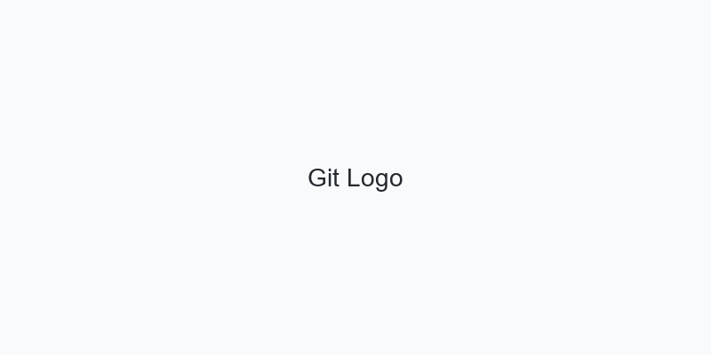
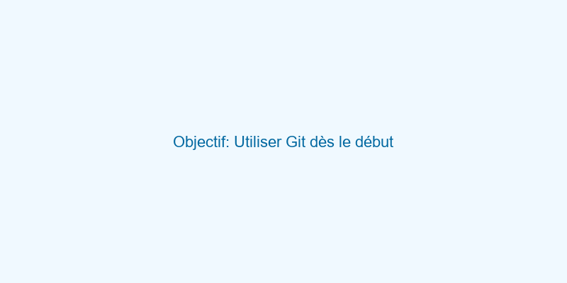
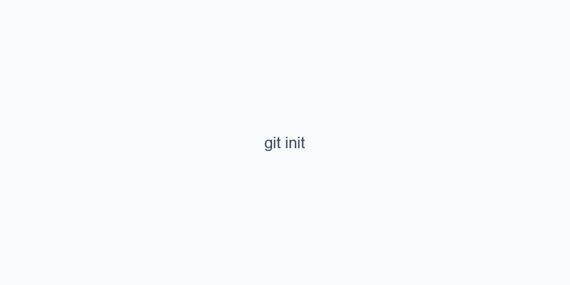
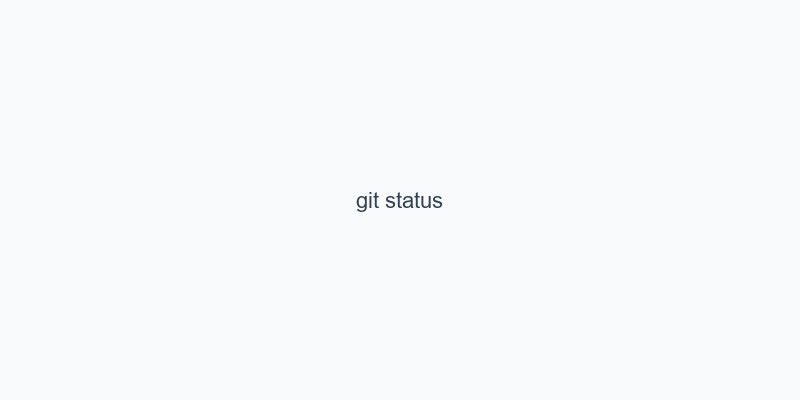
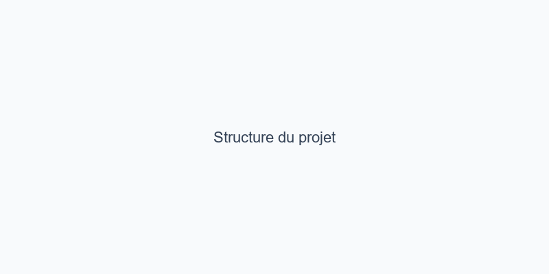
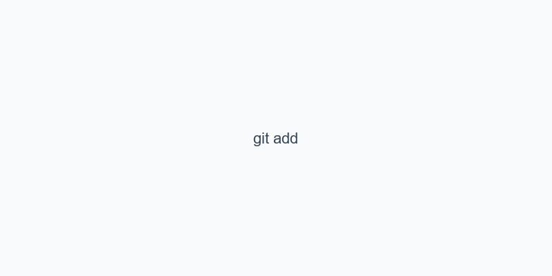
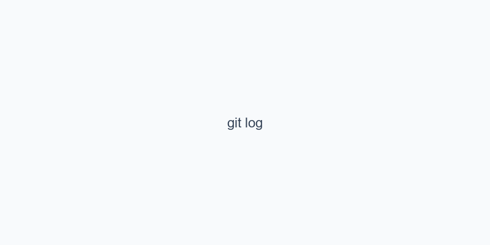
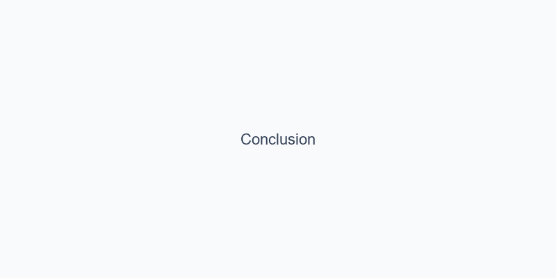
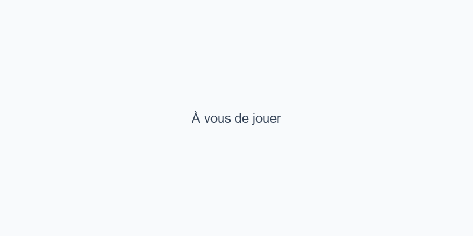

# Lab-Git

## Utiliser Git dès le début du projet

---

# Objectif

---

# 1. Initialiser un dépôt Git

---

# 2. Vérifier l'état du dépôt

---

# 3. Créer la structure du projet

---

# 4. Ajouter les fichiers à l'index

---

# 5. Créer un premier commit

---

# 6. Vérifier l'historique

---

# 7. Conclusion

---

# À vous de jouer

